<div align="center">

<a href="https://github.com/Ben-coderr/robot-car">
  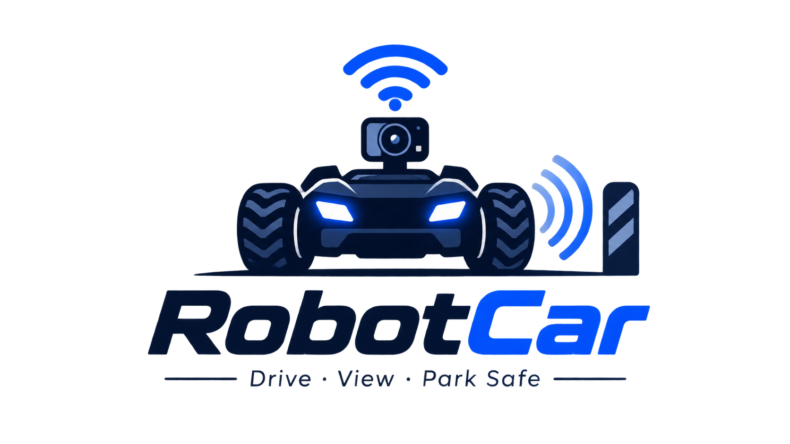
</a>

<br><br>

# 🚗 Autonomous & Teleoperated 4WD Smart Rover
### Dual-Core Architecture (ESP32-CAM + Arduino UNO) · FPV Video Stream · Rear Sonar Radar · Auto-Brake · Zero-Install Web App

[](https://www.arduino.cc/)
[](#)
[](#)
[](#)
[](https://ben-coderr.github.io/robot-car/3d/robot_car_3d_viewer.html)
[](https://github.com/Ben-coderr/robot-car/releases/latest)
[](LICENSE)

<br><br>

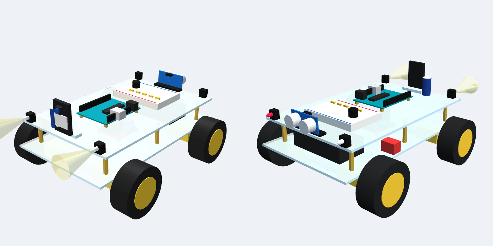

<p align="center">
  <b>A complete, classroom-tested open-source robotics platform combining computer vision, wireless teleoperation, and deterministic real-time hardware safety.</b>
</p>

</div>

---

## 📑 Table of Contents

* [✨ Key Features](#-key-features)
* [🏗️ System Architecture & Data Flow](#-system-architecture--data-flow)
* [⚡ Complete Electrical Wiring & Schematic](#-complete-electrical-wiring--schematic)
* [📐 Mechanical Layout & 3D Assembly](#-mechanical-layout--3d-assembly)
* [📱 Zero-Install Web Application](#-zero-install-web-application)
* [🧩 Hardware Bill of Materials (BOM)](#-hardware-bill-of-materials-bom)
* [🔌 Complete Pinout Mapping](#-complete-pinout-mapping)
* [🚀 Quick Start & Firmware Upload Guide](#-quick-start--firmware-upload-guide)
* [🧪 Progressive Hardware Diagnostic Tests](#-progressive-hardware-diagnostic-tests)
* [📚 Complete PDF Handbooks Library](#-complete-pdf-handbooks-library)
* [📂 Repository Structure](#-repository-structure)
* [📜 License](#-license)

---

## ✨ Key Features

* **🎥 Ultra-Low Latency FPV Video**: AI-Thinker ESP32-CAM module delivers real-time MJPEG video over local Wi-Fi with sub-100ms latency.
* **📱 Zero-Install Teleoperation App**: Accessible from any smartphone, tablet, or PC browser via `http://192.168.4.1` with touch joystick, speed gears, camera settings, and keyboard hotkeys.
* **🖥️ Dedicated Classroom Observation Viewer**: Dual-screen web experience at `http://192.168.4.1/view` offering synchronized instrument gauges, telemetry graphs, and client tracking for up to 3 screens.
* **🛡️ Rear Ultrasonic Parking Radar & Auto-Brake**: Rear-mounted HC-SR04 sonar with an active acoustic beeper and red flashing beacon. Features **hardware auto-braking** that stops reversing if an obstacle is within 15 cm.
* **💡 High-Intensity Lighting & Hazard System**: Dual front white headlights with **OFF / ON / HAZARD** flasher modes and white rear reverse indicator LED.
* **⚙️ Dual-Microcontroller Architecture**: Distributes wireless networking (ESP32) and real-time motor control (Arduino Uno) across dedicated hardware with hardware watchdog fail-safes.
* **🔋 Single Battery Supply (No Buck Converter)**: Runs on 2× 18650 Li-ion cells (7.4V nominal) directly feeding the L298N motor driver and Arduino Uno VIN pin, with a 2200 µF buffer capacitor preventing brownout resets.

---

## 🏗️ System Architecture & Data Flow

```
┌─────────────────────────────────┐
│          CLIENT DEVICE          │
│   (Phone / Tablet / Laptop)     │
│  http://192.168.4.1 [Browser]   │
└────────────────┬────────────────┘
                 │
                 │ 1. Wi-Fi 802.11b/g/n (SSID: RobotCar)
                 │    - WebSocket ws://192.168.4.1/ws (Bidirectional Telemetry)
                 │    - MJPEG Video Stream :81/stream (Sub-100ms Video)
                 ▼
┌─────────────────────────────────┐
│        ESP32-CAM MODULE         │
│   (Network & Telemetry Host)    │
│  - AI-Thinker OV2640 Camera     │
│  - Web & WebSocket Server       │
│  - High-Power Flash (IO4)       │
└────────────────┬────────────────┘
                 │
                 │ 2. Hardware UART Serial (38,400 Baud)
                 │    - IO14 (TX, 3.3V) ──────► Arduino D3 (RX)
                 │    - IO15 (RX, 3.3V) ◄────── 1k/2k Divider ◄── Arduino D2 (TX, 5V)
                 │    - Checksum Protected Packets: M,left,right*XX
                 ▼
┌─────────────────────────────────┐
│         ARDUINO UNO R3          │
│    (Deterministic Real-Time)    │
│  - Real-Time Ultrasonic Echo    │
│  - Hardware Fail-Safe Watchdog  │
│  - Smooth PWM Motor Slew Ramping│
└───────┬──────────────┬──────────┘
        │              │
        ▼              ▼
┌──────────────┐ ┌──────────────┐
│ L298N DRIVER │ │ SENSORS & IO │
│ 4x TT Motors │ │ HC-SR04 Sonar│
│ Dual H-Bridge│ │ Active Buzzer│
│ PWM Speed    │ │ 4x LEDs      │
└──────────────┘ └──────────────┘
```

---

## ⚡ Complete Electrical Wiring & Schematic

The robot car uses a single 7.4V battery pack (2× 18650 cells in series) without requiring an external buck converter. The battery directly powers the L298N motor driver and the Arduino Uno `VIN` pin. The Arduino Uno's onboard linear regulator produces the 5V logic bus for all sensors and the ESP32-CAM, buffered by a **2200 µF 16V low-ESR capacitor**.

### Comprehensive Assembly Wiring
<div align="center">
  <a href="docs/02_WIRING.md">
    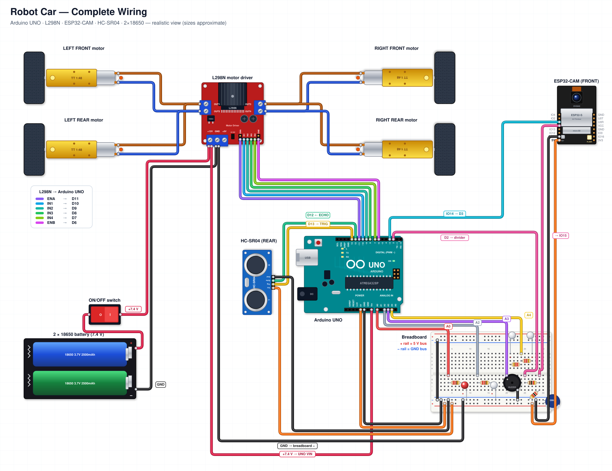
  </a>
  <p><i>Click diagram to open the step-by-step wiring guide.</i></p>
</div>

### Complete Circuit Schematic
<div align="center">
  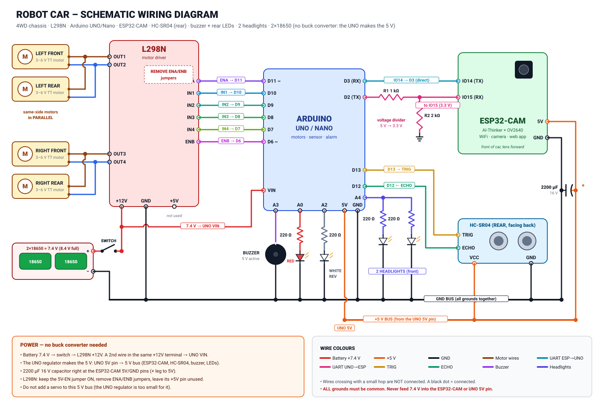
</div>

---

## 📐 Mechanical Layout & 3D Assembly

The vehicle is built on a double-decker acrylic 4WD chassis with dedicated spatial separation between high-current inductive components and sensitive radio-frequency electronics:

<div align="center">
  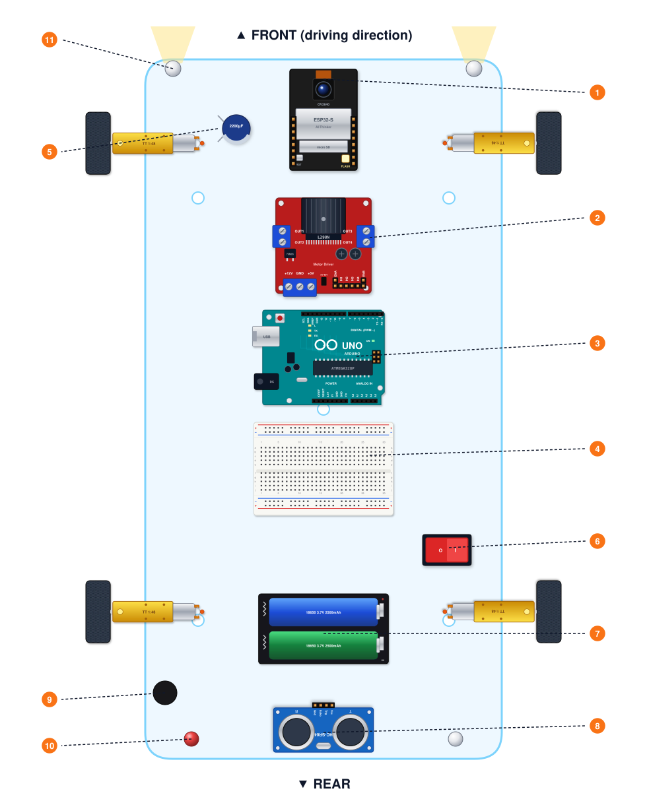
</div>

* **Interactive 3D CAD Viewer**: Open [`docs/3d/robot_car_3d_viewer.html`](docs/3d/robot_car_3d_viewer.html) in your browser to inspect and rotate the complete 3D assembly.
* **Parametric 3D Files**: Ready-to-print 3D models available at [`docs/3d/robot_car_assembly.stl`](docs/3d/robot_car_assembly.stl) and [`docs/3d/robot_car_assembly.3mf`](docs/3d/robot_car_assembly.3mf).

---

## 📱 Zero-Install Web Application

No app store downloads or native compilation required. Connect to the car's Wi-Fi network and open `http://192.168.4.1` in Safari, Chrome, Firefox, or Edge.

<div align="center">
  <table border="0">
    <tr>
      <td align="center" width="50%">
        <b>📱 Mobile Driver Interface (Portrait)</b><br><br>
        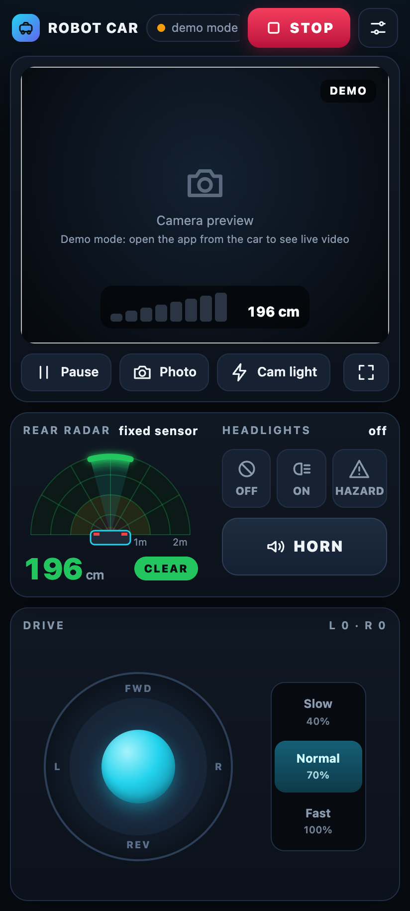
      </td>
      <td align="center" width="50%">
        <b>📱 Mobile Driver Interface (Landscape)</b><br><br>
        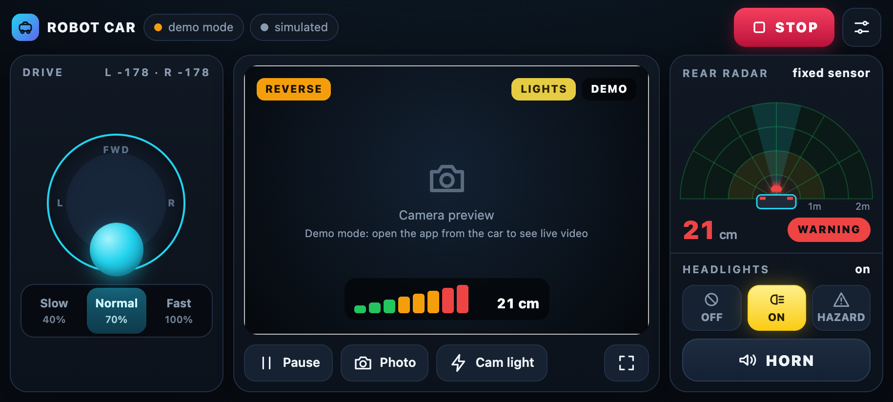
      </td>
    </tr>
    <tr>
      <td align="center" width="50%">
        <b>🖥️ Classroom Observation Viewer (<code>/view</code>)</b><br><br>
        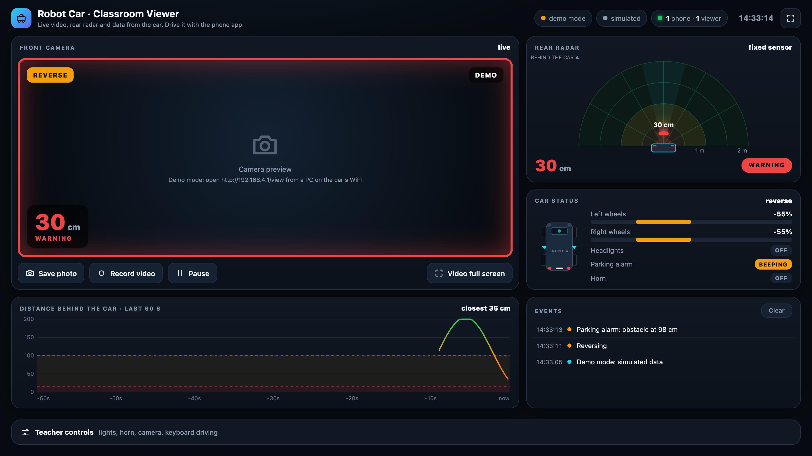
      </td>
      <td align="center" width="50%">
        <b>⚙️ Real-Time Settings & Calibration Panel</b><br><br>
        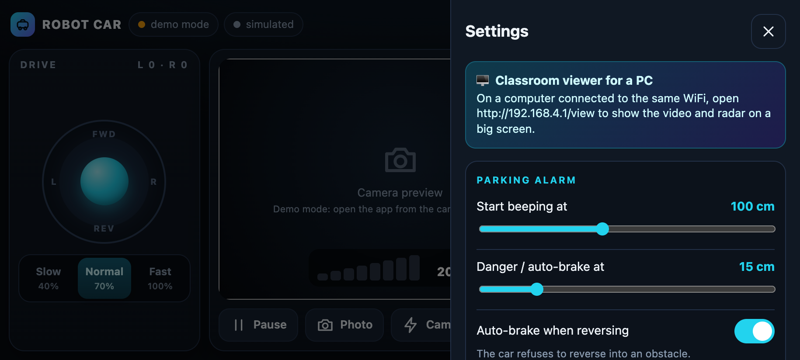
      </td>
    </tr>
  </table>
</div>

---

## 🧩 Hardware Bill of Materials (BOM)

For complete shopping links and price estimates, see [`docs/01_BOM.md`](docs/01_BOM.md) and [`docs/pdf/Shopping_List_Robot_Car.pdf`](docs/pdf/Shopping_List_Robot_Car.pdf).

<div align="center">

| Microcontroller | Camera Module | Motor Driver | Distance Sensor |
|:---:|:---:|:---:|:---:|
| 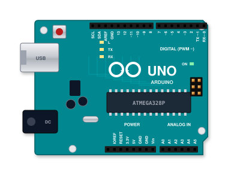 | 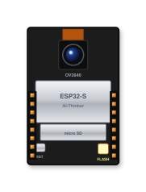 | 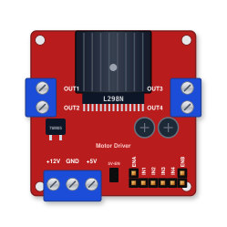 | 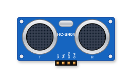 |
| **Arduino UNO R3** | **ESP32-CAM Module** | **L298N Dual H-Bridge** | **HC-SR04 Ultrasonic** |

| Power Source | TT Gear Motors | Breadboard & Rails | Active Buzzer |
|:---:|:---:|:---:|:---:|
| 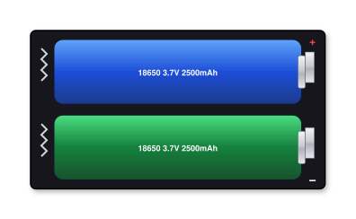 | 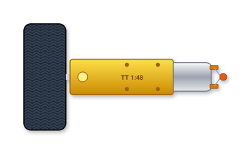 | 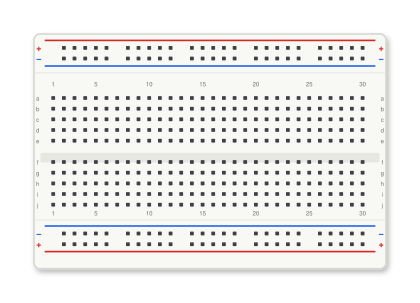 |  |
| **2× 18650 Li-ion + Case** | **4× TT Motors (1:48)** | **400-Point Breadboard** | **5V Active Buzzer** |

| LEDs & Indicators | Filter Capacitor | Resistors & Divider | Power Switch |
|:---:|:---:|:---:|:---:|
| 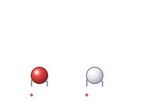 | 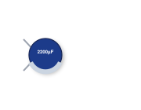 | 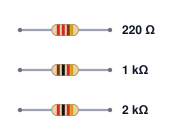 | 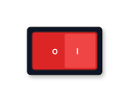 |
| **Headlights & Tail LEDs** | **2200 µF 16V Low-ESR** | **220 Ω, 1 kΩ, 2 kΩ** | **SPST Rocker Switch** |

</div>

---

## 🔌 Complete Pinout Mapping

| Arduino UNO Pin | Subsystem | Connected Device | Logic Voltage | Function |
|:---:|:---:|:---|:---:|:---|
| **D2** | Telemetry TX | 1k/2k Divider → ESP32-CAM IO15 | 5.0V TTL | Transmits telemetry and heartbeat to ESP32 |
| **D3** | Telemetry RX | ESP32-CAM IO14 (TX) | 3.3V CMOS | Receives drive commands from ESP32 |
| **D6 ~** | Motor Right | L298N ENB | 5.0V PWM | Right motor pair speed PWM (0–255) |
| **D7** | Motor Right | L298N IN4 | 5.0V Digital | Right motor pair direction bit 2 |
| **D8** | Motor Right | L298N IN3 | 5.0V Digital | Right motor pair direction bit 1 |
| **D9** | Motor Left | L298N IN2 | 5.0V Digital | Left motor pair direction bit 2 |
| **D10** | Motor Left | L298N IN1 | 5.0V Digital | Left motor pair direction bit 1 |
| **D11 ~** | Motor Left | L298N ENA | 5.0V PWM | Left motor pair speed PWM (0–255) |
| **D12** | Sonar Sensor | HC-SR04 ECHO | 5.0V Digital | Ultrasonic pulse return input |
| **D13** | Sonar Sensor | HC-SR04 TRIG | 5.0V Digital | Ultrasonic 10 µs trigger pulse output |
| **A0** | Rear Alarm | Red Warning LED (via 220 Ω) | 5.0V Digital | Flashing proximity alert indicator |
| **A2** | Rear Indicator| White Reverse LED (via 220 Ω) | 5.0V Digital | Active reverse drive lamp |
| **A3** | Audio Alert | 5V Active Acoustic Buzzer | 5.0V Digital | Parking beeper & acoustic horn |
| **A4** | Front Lighting| 2× White Headlights (2× 220 Ω) | 5.0V Digital | Front headlights (Off / On / Hazard) |
| **VIN** | Power Supply | Switched Battery Positive (7.4V) | Battery DC | Feeds onboard 5V linear regulator |
| **5V / GND**| System Bus | Breadboard Power Rails | 5.0V DC | Master logic power distribution |

---

## 🚀 Quick Start & Firmware Upload Guide

### 1. Arduino IDE Setup
1. Install **Arduino IDE 2.x** from [arduino.cc](https://www.arduino.cc/en/software).
2. Add ESP32 package repository in **Preferences** → **Additional boards manager URLs**:
   ```text
   https://espressif.github.io/arduino-esp32/package_esp32_index.json
   ```
3. Install **esp32 by Espressif Systems** from the Boards Manager.

### 2. Flashing the Controllers
* **Arduino UNO**: Open `firmware/uno_controller/uno_controller.ino`, select **Board: Arduino Uno**, and click **Upload**.
* **ESP32-CAM**: Open `firmware/esp32cam_robot/esp32cam_robot.ino`, select **Board: AI Thinker ESP32-CAM**, set **Partition Scheme: Huge APP (3MB No OTA)**, and click **Upload** via the ESP32-CAM-MB daughterboard.

### 3. Connect & Drive
1. Turn on the vehicle battery switch.
2. Connect your mobile phone or PC to Wi-Fi SSID **`RobotCar`** (Password: **`12345678`**).
3. Open **`http://192.168.4.1`** to drive, or **`http://192.168.4.1/view`** for classroom observation!

---

## 🧪 Progressive Hardware Diagnostic Tests

The project includes six progressive diagnostic test sketches in the `tests/` directory to systematically verify each component before full operation:

```
tests/
├── 01_motor_test/            # Tests L298N H-Bridge and 4x TT DC motors independently
├── 02_ultrasonic_test/       # Calibrates HC-SR04 sonar distance sensor via Serial Monitor
├── 03_buzzer_led_test/       # Tests active buzzer, headlights, reverse light, and warning LED
├── 04_link_test/             # Verifies hardware UART link between Arduino Uno and ESP32-CAM
├── 05_esp32cam_test/         # Standalone camera, Wi-Fi stream, and flash LED verification
└── 06_parking_alarm_bench/   # Bench validation of obstacle distance thresholds & auto-brake
```

---

## 📚 Complete PDF Handbooks Library

The `docs/pdf/` directory contains complete, classroom-ready illustrated documentation:

| Document | File Path | Scope & Content |
|:---|:---|:---|
| 📖 **Complete Handbook** | [`docs/pdf/00_Robot_Car_Complete_Handbook.pdf`](docs/pdf/00_Robot_Car_Complete_Handbook.pdf) | Comprehensive student manual (all modules combined) |
| 🛒 **Shopping & Parts List** | [`docs/pdf/Shopping_List_Robot_Car.pdf`](docs/pdf/Shopping_List_Robot_Car.pdf) | Complete parts bill with specifications and supplier links |
| 🔌 **Illustrated Wiring Guide** | [`docs/pdf/02_Wiring_Guide.pdf`](docs/pdf/02_Wiring_Guide.pdf) | Step-by-step visual wiring walkthrough |
| 🖼️ **Large Wiring Poster** | [`docs/pdf/Robot_Car_Wiring_Poster.pdf`](docs/pdf/Robot_Car_Wiring_Poster.pdf) | High-resolution printable A3 workbench wiring poster |
| 🛠️ **Assembly Guide** | [`docs/pdf/03_Assembly_Guide.pdf`](docs/pdf/03_Assembly_Guide.pdf) | Mechanical chassis assembly and component layout |
| 💻 **Software & App Guide** | [`docs/pdf/04_Software_and_App_Guide.pdf`](docs/pdf/04_Software_and_App_Guide.pdf) | Arduino IDE setup, firmware upload, and web app operation |
| 🩺 **Testing & Troubleshooting** | [`docs/pdf/05_Testing_and_Troubleshooting.pdf`](docs/pdf/05_Testing_and_Troubleshooting.pdf) | Bench testing protocols and fault diagnosis |
| ⚙️ **Technical Reference** | [`docs/pdf/06_Technical_Reference.pdf`](docs/pdf/06_Technical_Reference.pdf) | Protocol specifications, math, and code architecture |
| 🎓 **Arduino Warm-Up Lessons** | [`docs/pdf/07_Warm_Up_Learn_Arduino.pdf`](docs/pdf/07_Warm_Up_Learn_Arduino.pdf) | Introductory programming lessons for beginners |

---

## 📂 Repository Structure

```
robot-car/
├── README.md                      # Primary project overview & documentation hub
├── LICENSE                        # Open-source MIT License
├── .gitignore                     # Git exclusion rules
├── firmware/
│   ├── uno_controller/            # Real-time motor, sonar, and alarm controller (Arduino UNO)
│   └── esp32cam_robot/            # Camera streaming, Wi-Fi AP, and WebSocket server (ESP32-CAM)
├── web/
│   ├── index.html                 # Mobile driving web app interface
│   └── view.html                  # Classroom observation dashboard
├── tests/                         # 6 progressive hardware diagnostic sketches
├── tools/
│   ├── build_ui.py                # Compiles web/ assets into C header files for ESP32
│   ├── 3d/make_3d_model.py        # Generates 3D STL, 3MF, and HTML CAD models
│   ├── diagrams/make_diagrams.py  # Generates SVG wiring and chassis diagrams
│   └── pdf/build_pdfs.py          # Builds printable PDF handbooks
└── docs/
    ├── 01_BOM.md                  # Detailed Bill of Materials
    ├── 02_WIRING.md               # Step-by-step wiring instructions
    ├── 03_ASSEMBLY.md             # Mechanical assembly instructions
    ├── 04_SOFTWARE_SETUP.md       # Arduino IDE and flashing guide
    ├── 05_PROTOCOL.md             # WebSocket & UART protocol specification
    ├── 06_TROUBLESHOOTING.md      # Testing and diagnosis procedures
    ├── 3d/                        # Interactive 3D HTML viewer, STL, and 3MF models
    ├── images/                    # Wiring diagrams, schematics, and UI screenshots
    └── pdf/                       # Printable student handbooks and posters
```

---

## 📜 License

This project is licensed under the permissive **MIT License**. You are free to study, build, modify, distribute, and integrate this project for educational and commercial purposes.
