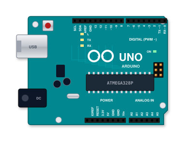
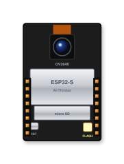
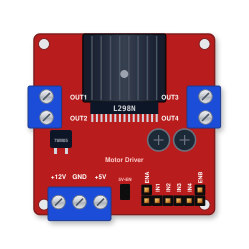
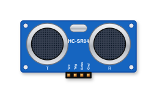
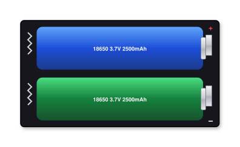
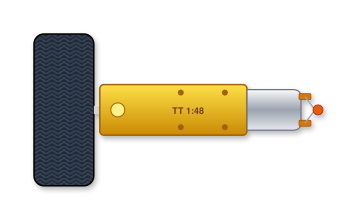
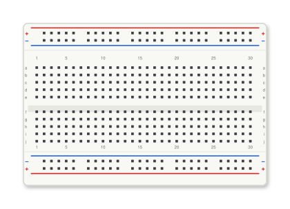
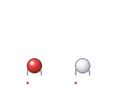
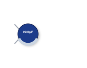
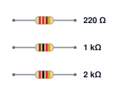

# 01 · Bill of Materials & Hardware Components

> **Printable Edition**: For an itemized list with purchase links, see [`docs/pdf/Shopping_List_Robot_Car.pdf`](pdf/Shopping_List_Robot_Car.pdf) and [`docs/pdf/01_Overview_and_Parts_List.pdf`](pdf/01_Overview_and_Parts_List.pdf).

---

## Visual Parts Gallery

| Microcontroller | Camera Module | Motor Driver | Distance Sensor |
|:---:|:---:|:---:|:---:|
|  |  |  |  |
| **Arduino UNO R3** | **ESP32-CAM (AI-Thinker)** | **L298N Dual H-Bridge** | **HC-SR04 Ultrasonic** |

| Power Source | TT Gear Motors | Breadboard & Rails | Active Buzzer |
|:---:|:---:|:---:|:---:|
|  |  |  |  |
| **2× 18650 Li-ion + Holder** | **4× TT Motors (1:48)** | **400-Point Breadboard** | **5V Active Buzzer** |

| LEDs & Indicators | Filter Capacitor | Resistors & Divider | Power Switch |
|:---:|:---:|:---:|:---:|
|  |  |  |  |
| **Headlights & Tail LEDs** | **2200 µF 16V Low-ESR** | **220 Ω, 1 kΩ, 2 kΩ** | **SPST Rocker Switch** |

---

## 1. Primary Components

| Component | Specification / Notes | Qty | Function |
|:---|:---|:---:|:---|
| **4WD Chassis Kit** | Dual acrylic plates, 4× TT DC gear motors (3–6V, 1:48 gear ratio), 4× 65mm rubber wheels, M3 standoffs and brass hardware | 1 | Mechanical foundation and drive train |
| **ESP32-CAM** | **AI-Thinker module**, OV2640 2MP camera, 4 MB external PSRAM, integrated 2.4 GHz 802.11b/g/n Wi-Fi | 1 | FPV video streamer, WebSocket web server, teleoperation host |
| **ESP32-CAM-MB** | Micro-USB daughterboard with CH340 USB-UART bridge, RST and IO0 flash buttons | 1 | Dedicated programmer and serial debugging interface |
| **Arduino UNO R3** | Microchip ATmega328P microcontroller (16 MHz, 5V logic). CH340 or 16U2 USB interface | 1 | Dedicated real-time motor controller, ultrasonic sonar timing, fail-safe brake |
| **L298N Motor Driver** | Dual H-bridge driver board with onboard 5V linear regulator and aluminum heatsink | 1 | High-current H-bridge driving the 4 TT motors from battery voltage |
| **HC-SR04** | 40 kHz ultrasonic range finder (2 cm to 400 cm range, 5V VCC, TTL TRIG/ECHO) | 1 | Rear distance detection for parking radar and automatic braking |
| **Buzzer** | **Active 5V DC buzzer** (generates audible 2.3 kHz beep when driven HIGH) | 1 | Acoustic proximity alarm and horn |
| **18650 Li-Ion Cells** | High-drain 3.7V nominal (4.2V fully charged), 2000–3000 mAh authentic capacity | 2 | Primary power supply in series (7.4V nominal, 8.4V peak) |
| **18650 Battery Holder** | 2-cell series holder with 22 AWG silicone leads | 1 | Secure battery housing |
| **Power Switch** | SPST Rocker or slide switch, rated ≥ 3A DC | 1 | Master DC power disconnect |

> ⚠️ **No External Buck Converter Required**: The dual 18650 pack (7.4V–8.4V) feeds the L298N `+12V` input, and a parallel branch feeds the Arduino UNO `VIN` pin. The onboard low-dropout regulator on the Arduino Uno cleanly produces the 5V logic rail for all sensors and the ESP32-CAM.

---

## 2. Discrete Electronics & Passives

| Component | Value / Rating | Qty | Usage / Location |
|:---|:---|:---:|:---|
| **White 5mm LEDs** | High-brightness white (VF ≈ 3.0V, 20 mA) | 3 | 2× Front Headlights (pin A4) + 1× White Reverse Light (pin A2) |
| **Red 5mm LED** | Standard red (VF ≈ 1.9V, 20 mA) | 1 | Rear Proximity Warning Beacon (pin A0) |
| **Current Limiting Resistors** | 220 Ω, 1/4W, 5% tolerance | 4 | One dedicated resistor in series with each LED |
| **Divider Top Resistor** | 1 kΩ, 1/4W, 1% or 5% tolerance | 1 | Top half of voltage divider (Arduino D2 TX → ESP32 IO15 RX) |
| **Divider Bottom Resistor** | 2 kΩ (or 2× 1 kΩ in series), 1/4W | 1 | Bottom half of voltage divider (IO15 to Ground: 5V → 3.3V) |
| **Bulk Buffer Capacitor** | **2200 µF, 16V** (electrolytic, low-ESR) | 1 | Directly across ESP32-CAM 5V and GND rails to eliminate brownout resets |
| **Motor Noise Decouplers** | 100 nF (0.1 µF, code "104") ceramic | 4 | Solder directly across terminals of each TT motor to suppress brush EMI |

---

## 3. Wiring, Hardware & Prototyping Tools

| Item | Details | Quantity |
|:---|:---|:---:|
| **Half-Size Breadboard** | 400 tie-points with dual power distribution buses | 1 |
| **Jumper Wires (M/F)** | Male-to-Female flexible jumpers, 20 cm | 1 pack (40 pcs) |
| **Jumper Wires (M/M)** | Male-to-Male flexible jumpers, 20 cm | 1 pack (40 pcs) |
| **Hookup Wire** | 22 AWG stranded copper wire (Red & Black) | 2 meters |
| **Fasteners & Spacers** | M3 nylon screws, nuts, and 25mm female/female standoffs | 1 assortment kit |
| **Adhesive & Ties** | 3M double-sided foam tape, 100mm zip ties, heat-shrink tubing | 1 set |
| **Li-Ion Smart Charger** | 2-bay CC/CV 18650 intelligent balance charger | 1 |

---

## 4. Electrical Load & Power Distribution

The power distribution network is designed to balance inductive motor loads against sensitive digital logic:

```
2x 18650 Cells (7.4V - 8.4V)
           │
     [Power Switch]
           ├───► L298N +12V Terminal ───► High-Current Motor Drives (OUT1-OUT4)
           │
           └───► Arduino Uno VIN Pin ───► Onboard 5V LDO Regulator
                                                  │
                                                  ▼
                                      Breadboard 5V Distribution Rail
                                                  ├───► ESP32-CAM 5V [Buffered by 2200µF Cap]
                                                  ├───► HC-SR04 Sonar (VCC)
                                                  ├───► Active Buzzer
                                                  └───► LEDs (via 220Ω ballasts)
```

| Subsystem | Power Rail | Idle Current | Operating Current | Peak Surge Current |
|:---|:---:|:---:|:---:|:---:|
| 4× TT Motors | 7.4V (L298N) | 0 mA | 600 – 1000 mA | 2500 mA (Stall / Reverse) |
| ESP32-CAM (WiFi + MJPEG) | 5V (UNO Reg) | 120 mA | 180 – 220 mA | 350 mA (Tx Bursts) |
| Arduino UNO Microcontroller | 5V (UNO Reg) | 45 mA | 50 mA | 55 mA |
| HC-SR04 Sonar Module | 5V (UNO Reg) | 2 mA | 15 mA | 20 mA |
| Active Buzzer & Status LEDs | 5V (UNO Reg) | 0 mA | 25 mA | 65 mA |
| **Total 5V Logic Bus Demand** | **5V** | **~167 mA** | **~270 mA** | **< 490 mA (Within Limits)** |

> 💡 **Engineering Tip**: The Arduino UNO onboard linear regulator safely supplies up to 500 mA when powered from 7.4V–8.4V. The massive **2200 µF capacitor** acts as a local energy reservoir, absorbing the millisecond 350 mA RF spikes produced by the ESP32-CAM during WiFi packet transmission.
