# 02 · Wiring Guide & Electrical Schematics

> **Printable High-Resolution Editions**: 
> * Step-by-step illustrated manual: [`docs/pdf/02_Wiring_Guide.pdf`](pdf/02_Wiring_Guide.pdf)
> * Large-format workbench poster: [`docs/pdf/Robot_Car_Wiring_Poster.pdf`](pdf/Robot_Car_Wiring_Poster.pdf)

---

## Complete Wiring Overview & Circuit Schematic

### Full Assembly Wiring
<div align="center">
  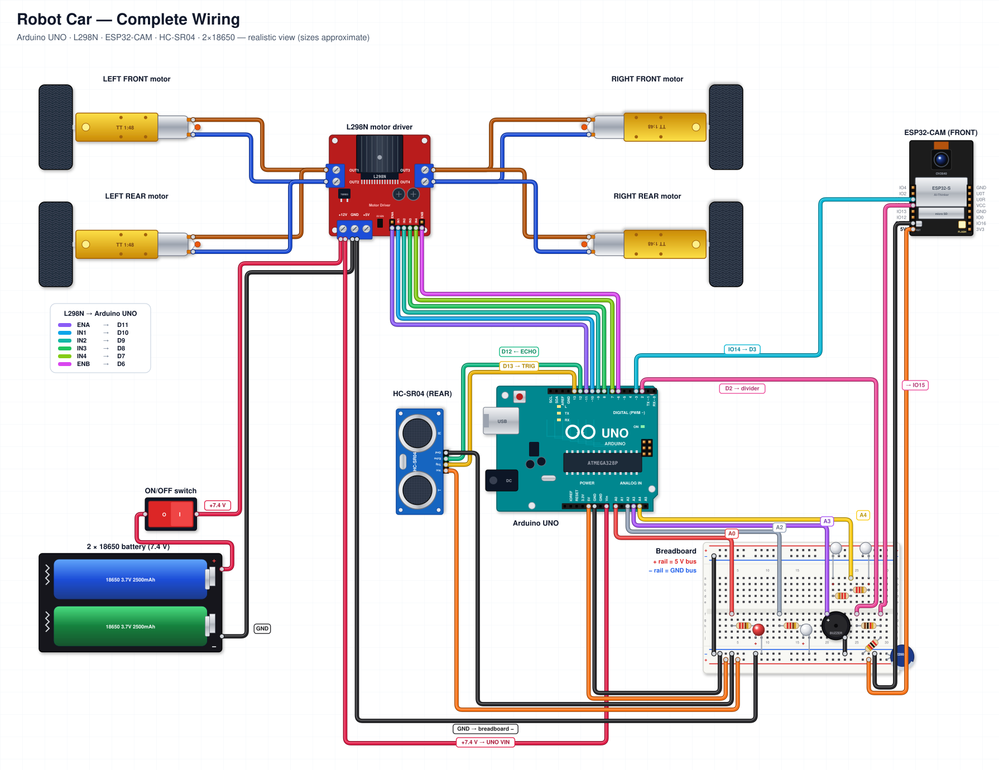
</div>

### Complete Electrical Schematic
<div align="center">
  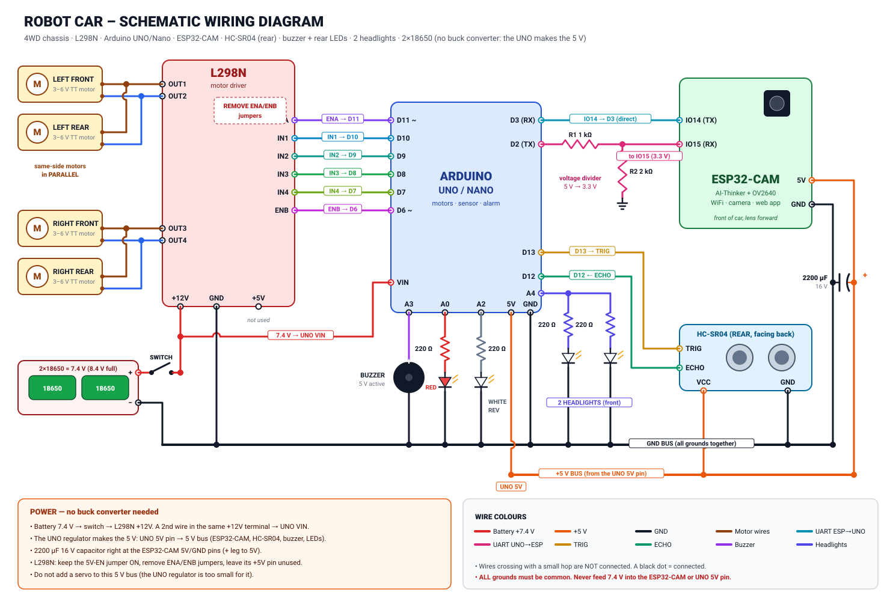
</div>

---

## ⚡ Fundamental Electrical Safety Rules

1. **Power Isolation During Assembly**: Always disconnect the battery harness or remove the 18650 cells while wiring.
2. **Polarity Verification**: Verify the battery terminal polarity with a digital multimeter before closing the main power switch for the first time.
3. **Common Ground Plane**: All grounds must be tied together into a single, low-impedance ground network: Battery (−), L298N GND, Arduino GND, ESP32-CAM GND, HC-SR04 GND, buzzer, and LED cathodes.
4. **Logic Voltage Safety**: 
   * **7.4V Battery Voltage** connects exclusively to L298N `+12V` and Arduino `VIN`. It must never come into contact with 5V or 3.3V logic pins.
   * **5V → 3.3V Logic Level Translation**: Arduino UNO outputs 5V TTL logic. ESP32 pins operate strictly at 3.3V. The Arduino `D2` (TX) pin connects to ESP32-CAM `IO15` (RX) **only through a 1 kΩ / 2 kΩ resistor voltage divider**. Connecting 5V directly to the ESP32 will permanently damage the silicon.
   * **3.3V → 5V Logic Compatibility**: ESP32-CAM `IO14` (TX) outputs 3.3V CMOS logic. The ATmega328P on the Uno recognises any voltage above 3.0V as a valid logic `HIGH`, so `IO14` connects directly to Arduino `D3` (RX) with no conversion needed.

---

## Step-by-Step Wiring Sequence

### Step 1 · Battery Power & Motor Driver Feed
Connect the high-capacity Li-ion battery pack through the master rocker switch into the L298N high-current terminals, and daisy-chain the 7.4V line to the Arduino `VIN` input.

<div align="center">
  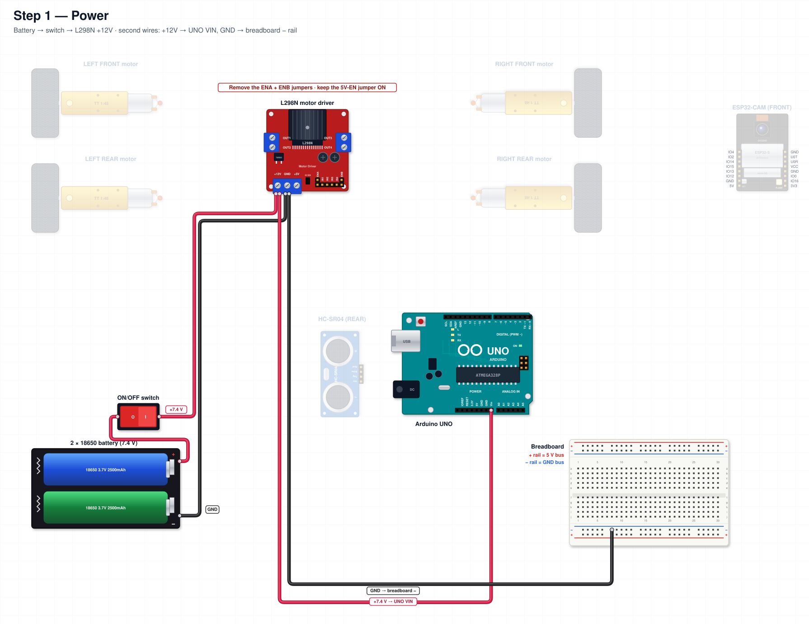
  <br>
  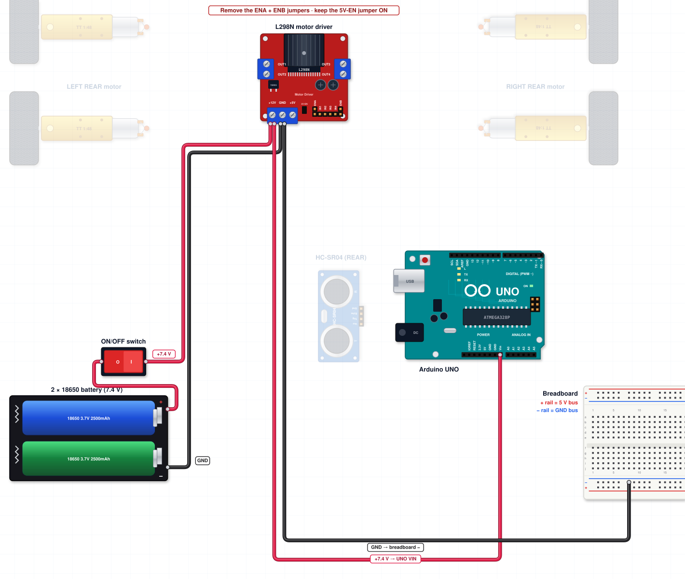
</div>

| Source Terminal | Destination Terminal | Wire Specification | Technical Purpose |
|:---|:---|:---|:---|
| Battery Pack (+) | Switch Input Terminal | 22 AWG Red | Raw 7.4V–8.4V power input |
| Switch Output | **L298N +12V Terminal** | 22 AWG Red | Switched battery positive rail |
| Battery Pack (−) | **L298N GND Terminal** | 22 AWG Black | Main high-current power return |
| L298N +12V (2nd wire in clamp) | **Arduino UNO VIN Pin** | 22 AWG Red | Feeds Arduino onboard 5V regulator |
| L298N GND (2nd wire in clamp) | **Breadboard Negative (−) Rail** | 22 AWG Black | Establishes master common ground |

> 📌 **L298N Jumper Configuration**:
> * **Remove the ENA and ENB black jumpers**: Speed control requires PWM from the Arduino.
> * **Keep the 5V-EN jumper installed**: Powers the internal L298N logic gates.
> * **Leave the L298N +5V screw terminal empty**: The 5V logic bus is provided cleanly by the Arduino Uno.

---

### Step 2 · Motor Installation & Noise Suppression
Wire the 4 TT motors into parallel pairs (left pair and right pair) and solder 100 nF ceramic capacitors across motor tabs.

<div align="center">
  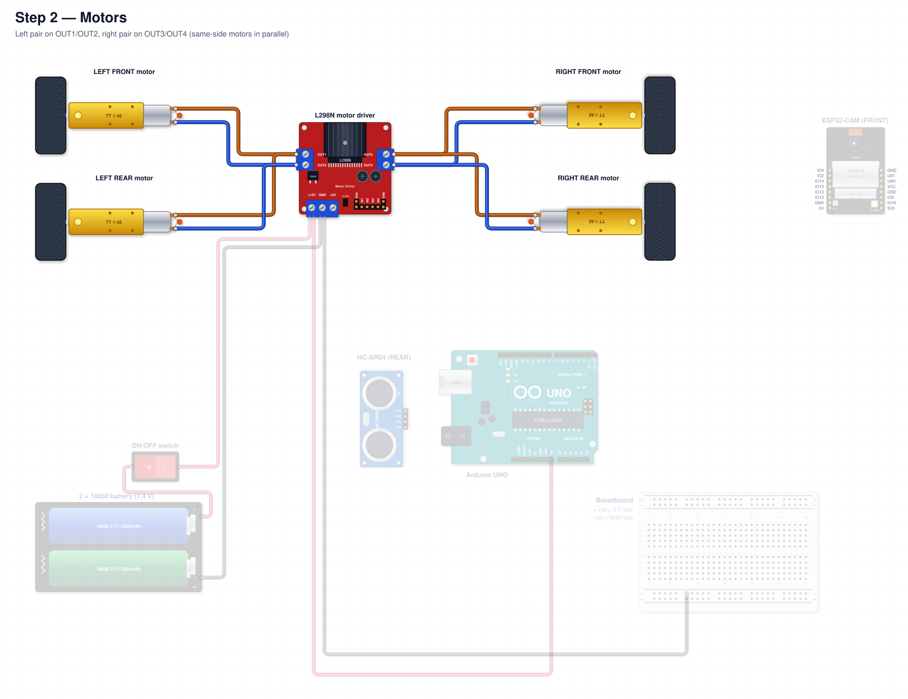
  <br>
  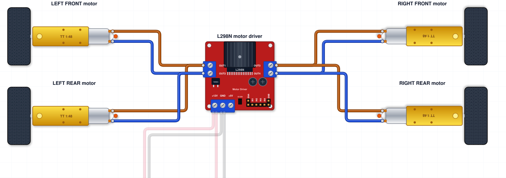
</div>

| Motor Pair | L298N Driver Terminals | Wire Recommendation | Notes |
|:---|:---|:---|:---|
| **Left Front + Left Rear** | **OUT1 & OUT2** | Twisted 22 AWG pair | Connected in parallel |
| **Right Front + Right Rear** | **OUT3 & OUT4** | Twisted 22 AWG pair | Connected in parallel |

> 💡 **EMI Noise Filter**: DC brush motors generate high-frequency electromagnetic noise when commutating. Soldering a **100 nF ("104") ceramic capacitor** across the positive and negative solder tabs of each motor absorbs brush arcing and prevents microcontroller lockups.

---

### Step 3 · Motor Driver Control Signals (L298N → Arduino UNO)
Connect the 6 direction and PWM speed lines from the L298N terminal strip to the Arduino digital pins.

<div align="center">
  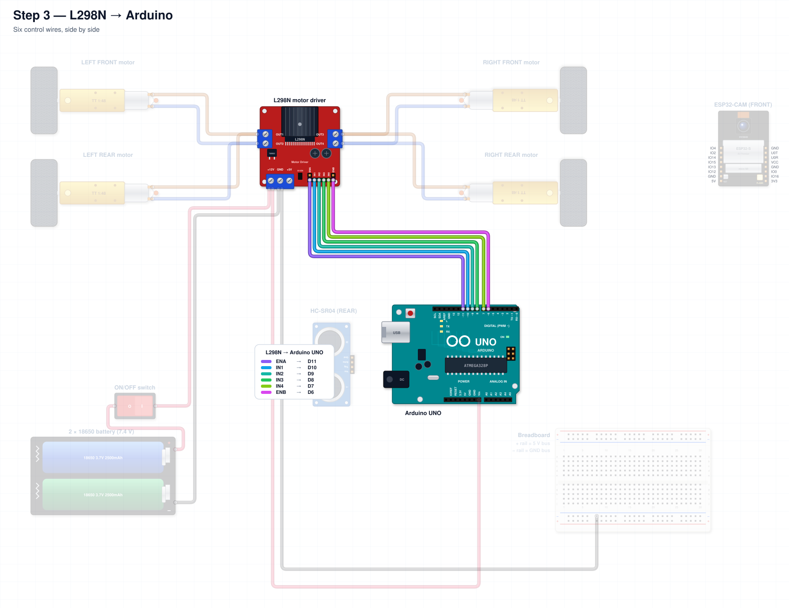
  <br>
  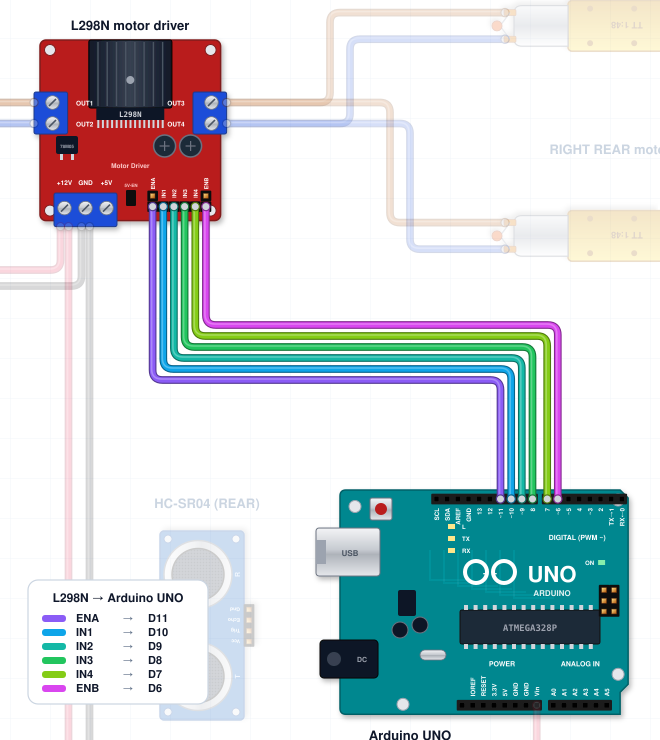
</div>

| L298N Pin | Arduino UNO Pin | Signal Type | Functional Role |
|:---:|:---:|:---:|:---|
| **ENA** | **D11 ~** | PWM (~490 Hz) | Left Track Speed Control (0–255) |
| **IN1** | **D10** | Digital Output | Left Track Direction Bit 1 |
| **IN2** | **D9** | Digital Output | Left Track Direction Bit 2 |
| **IN3** | **D8** | Digital Output | Right Track Direction Bit 1 |
| **IN4** | **D7** | Digital Output | Right Track Direction Bit 2 |
| **ENB** | **D6 ~** | PWM (~980 Hz) | Right Track Speed Control (0–255) |

---

### Step 4 · Logic Power Rail Distribution
Establish the regulated 5.0V bus and common ground from the Arduino Uno to the breadboard rails.

<div align="center">
  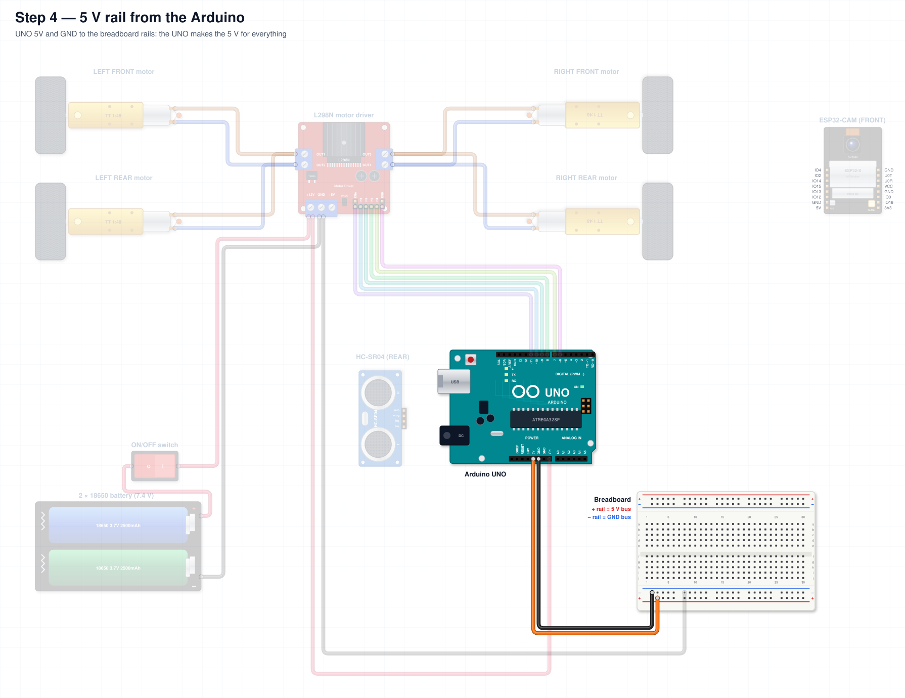
  <br>
  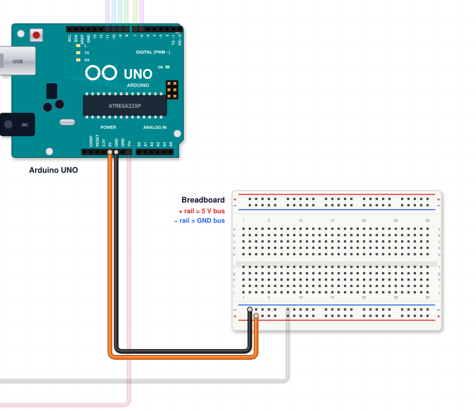
</div>

| Arduino UNO Pin | Breadboard Terminal | Electrical Voltage | Description |
|:---:|:---:|:---:|:---|
| **5V Pin** | **Bottom Positive (+) Rail** | +5.0V DC (±2%) | Regulated low-noise logic supply bus |
| **GND Pin** | **Bottom Negative (−) Rail** | 0.0V (Ground) | System signal ground reference |

---

### Step 5 · Rear Ultrasonic Sensor (HC-SR04)
Mount the ultrasonic sonar module facing the rear of the vehicle to monitor reverse obstacles.

<div align="center">
  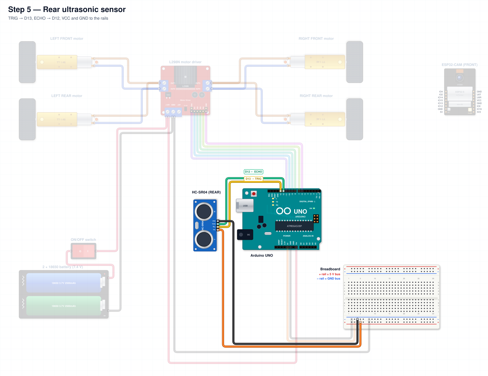
  <br>
  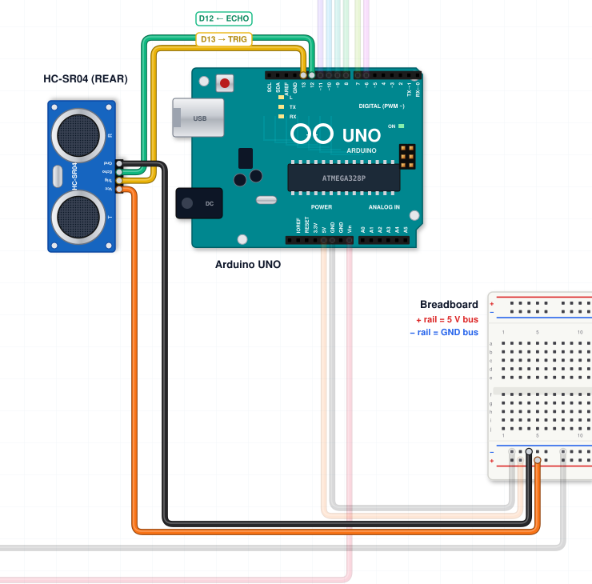
</div>

| HC-SR04 Sonar Pin | Arduino / Breadboard Connection | Function |
|:---:|:---:|:---|
| **VCC** | Breadboard Positive (+) Rail | 5V Operating Supply |
| **TRIG** | **Arduino Pin D13** | 10 µs High Trigger Pulse |
| **ECHO** | **Arduino Pin D12** | Echo Return Pulse Width |
| **GND** | Breadboard Negative (−) Rail | Ground Return |

---

### Step 6 · Audio-Visual Signaling: Headlights, Reverse Light & Buzzer
Connect the active buzzer, rear warning indicators, and dual front high-intensity headlights.

<div align="center">
  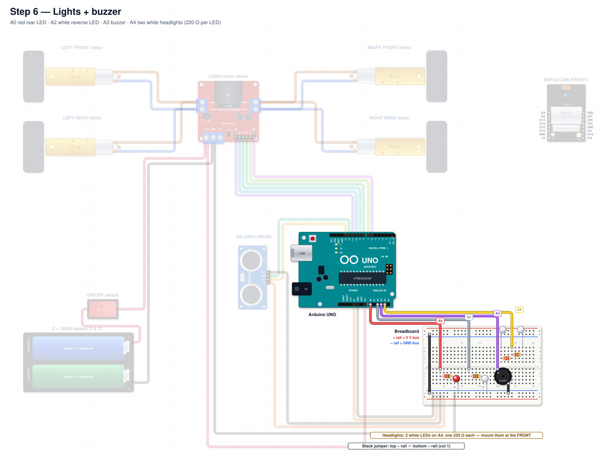
  <br>
  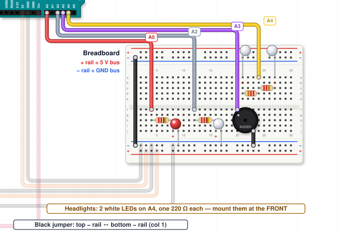
</div>

| Arduino Pin | Breadboard Node & Resistor | Component | Placement & Function |
|:---:|:---|:---|:---|
| **A0** | Row 4f → 220 Ω (4h→8h) → Anode 8j | **Red 5mm LED** | Left rear chassis corner (Hazard & proximity alarm) |
| **A2** | Row 12f → 220 Ω (12h→16h) → Anode 16j | **White 5mm LED** | Right rear chassis corner (Reverse light indicator) |
| **A3** | Row 20f → Anode 20h, Cathode 23h | **Active 5V Buzzer** | Rear chassis center (Parking beeper & horn) |
| **A4** | Row 24a → 220 Ω (24c→27c) → Anode 27a | **White 5mm LED #1** | Front left headlight (Off / On / Hazard mode) |
| **(A4)** | Row 24a → 220 Ω (24d→21d) → Anode 21a | **White 5mm LED #2** | Front right headlight (Off / On / Hazard mode) |
| **Bridge** | Top (−) Rail to Bottom (−) Rail | Jumper wire | Ground return for top breadboard rail |

---

### Step 7 · ESP32-CAM Serial Telemetry & Voltage Divider
Connect the ESP32-CAM module to the 5V power bus, install the 2200 µF capacitor, and wire the bidirectional UART link with the level-shifting voltage divider.

<div align="center">
  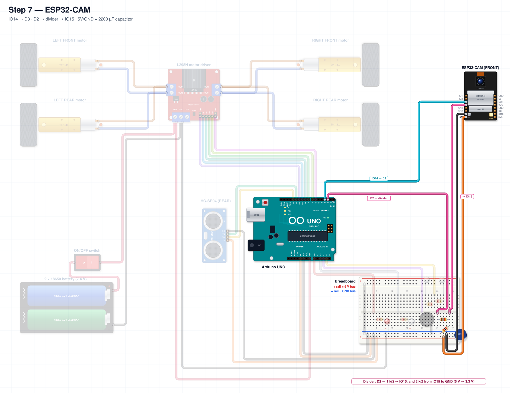
  <br>
  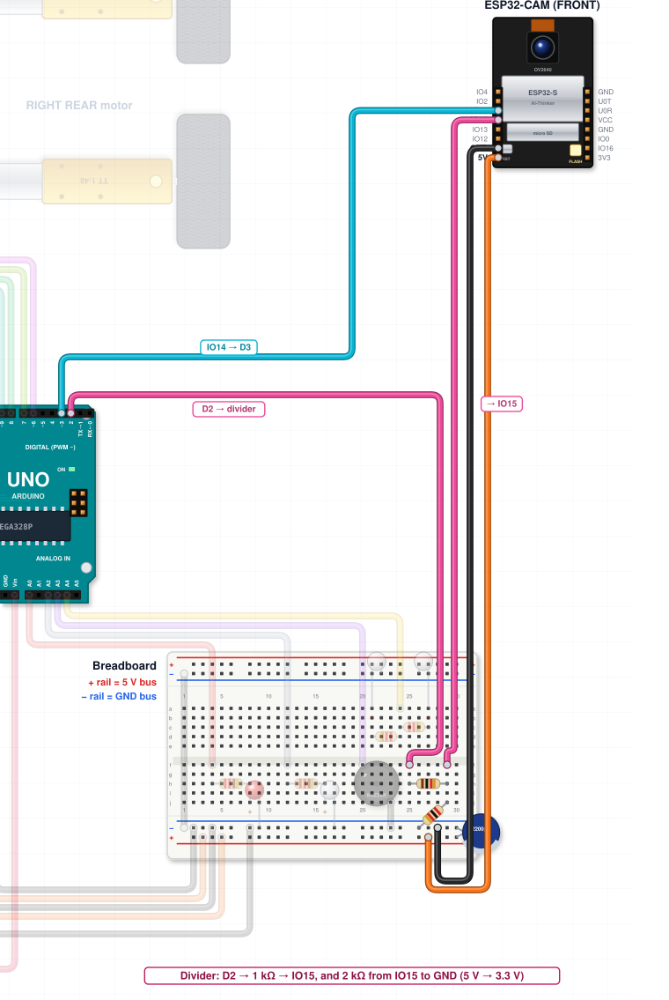
</div>

```
Arduino D2 (TX, 5V) ────► [ 1 kΩ Resistor ] ────┬────► ESP32-CAM IO15 (RX, 3.3V)
                                                │
                                         [ 2 kΩ Resistor ]
                                                │
                                                ▼
                                           Common Ground
```

$$\text{V}_{\text{IO15}} = 5.0\,\text{V} \times \frac{2\,\text{k}\Omega}{1\,\text{k}\Omega + 2\,\text{k}\Omega} = 5.0\,\text{V} \times \frac{2}{3} = 3.33\,\text{V}$$

| Connection Point | Linked To | Wire / Component | Critical Detail |
|:---|:---|:---|:---|
| **ESP32-CAM 5V** | Breadboard Positive (+) Rail | Red Jumper | **Connect to 5V, never to 3V3 pin!** |
| **ESP32-CAM GND** | Breadboard Negative (−) Rail | Black Jumper | Direct ground return |
| **ESP32-CAM IO14 (TX)** | **Arduino Pin D3 (RX)** | Yellow Jumper | Direct wire (3.3V meets Arduino HIGH threshold) |
| **Arduino Pin D2 (TX)** | Breadboard Row 25f | Orange Jumper | 5V Transmit signal from Uno |
| **Row 25h to Row 29h** | In-series across rows | **1 kΩ Resistor** | Top resistor of voltage divider |
| **Row 29j to (−) Rail** | Row 29 to Ground rail | **2 kΩ Resistor** | Bottom resistor of voltage divider |
| **Row 29f** | **ESP32-CAM IO15 (RX)** | Blue Jumper | Safe 3.33V level-shifted receive line |
| **2200 µF 16V Capacitor** | Direct across (+) and (−) rails | Electrolytic Capacitor | **Long lead to (+), white stripe lead to (−)** |

---

## Complete Pin Assignment Summary

| Arduino UNO Pin | Subsystem | Connected Device | Voltage Logic |
|:---:|:---:|:---|:---:|
| **D2** | UART TX | Voltage Divider (1k/2k) → ESP32-CAM IO15 | 5.0V TTL |
| **D3** | UART RX | ESP32-CAM IO14 (TX) | 3.3V CMOS |
| **D6 ~** | Motor Right | L298N ENB (Right Speed PWM) | 5.0V PWM |
| **D7** | Motor Right | L298N IN4 (Right Direction 2) | 5.0V Digital |
| **D8** | Motor Right | L298N IN3 (Right Direction 1) | 5.0V Digital |
| **D9** | Motor Left | L298N IN2 (Left Direction 2) | 5.0V Digital |
| **D10** | Motor Left | L298N IN1 (Left Direction 1) | 5.0V Digital |
| **D11 ~** | Motor Left | L298N ENA (Left Speed PWM) | 5.0V PWM |
| **D12** | Sonar | HC-SR04 ECHO | 5.0V Digital |
| **D13** | Sonar | HC-SR04 TRIG | 5.0V Digital |
| **A0** | Alarm | Rear Red Warning LED (via 220 Ω) | 5.0V Digital |
| **A1** | Expansion | Optional SG90 Radar Scanning Servo | 5.0V PWM |
| **A2** | Indicator | Rear White Reverse LED (via 220 Ω) | 5.0V Digital |
| **A3** | Audio | 5V Active Acoustic Buzzer | 5.0V Digital |
| **A4** | Lighting | Dual White Front Headlights (2× 220 Ω) | 5.0V Digital |
| **VIN** | Power In | Switched Battery Positive (7.4V–8.4V) | Battery DC |
| **5V** | Power Out | Breadboard Positive Rail | 5.0V Regulated |
| **GND** | Ground | Breadboard Negative Rail & L298N GND | Common Ground |
