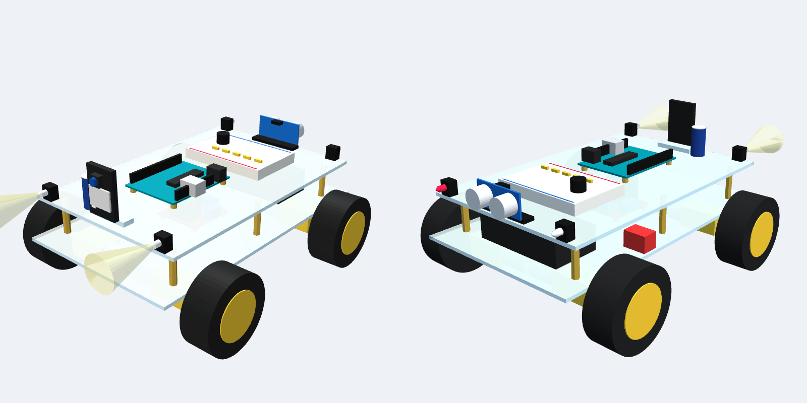
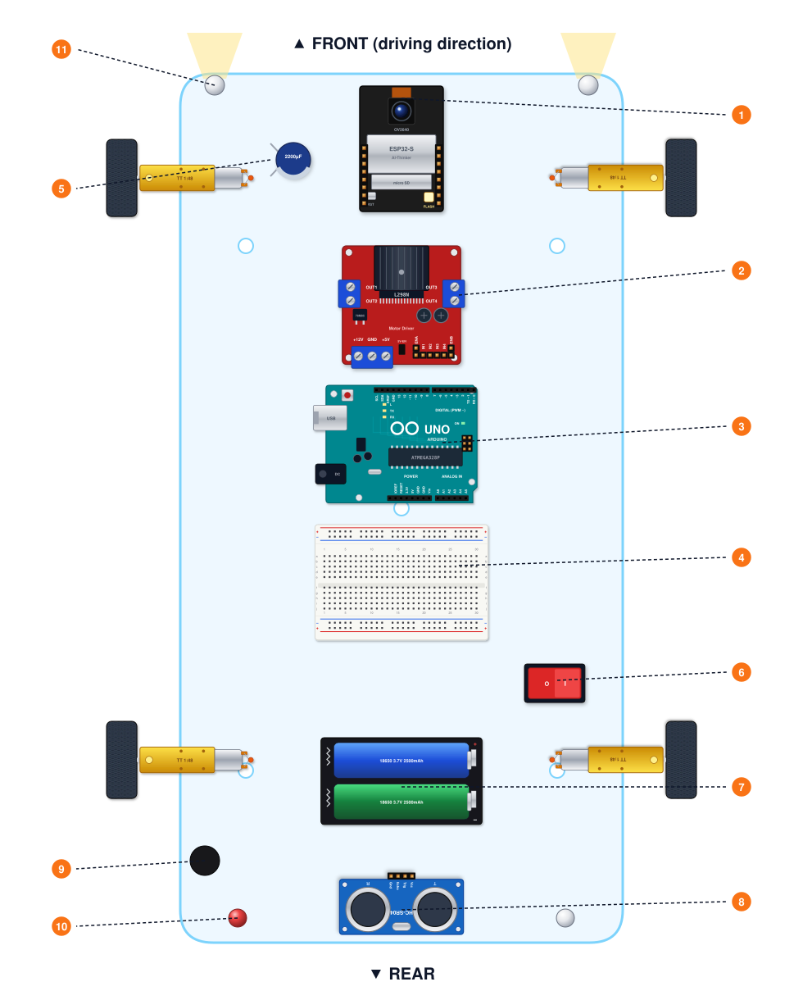

# 03 · Mechanical Assembly & Chassis Layout

> **Printable Edition**: For step-by-step mechanical drawings, see [`docs/pdf/03_Assembly_Guide.pdf`](pdf/03_Assembly_Guide.pdf).  
> **Interactive 3D Assembly**: Open [`docs/3d/robot_car_3d_viewer.html`](3d/robot_car_3d_viewer.html) in any web browser to view, rotate, inspect, and explode the 3D CAD model.

---

## 3D Assembly Preview & Chassis Layout

### 3D Render of Finished Vehicle

  

### Top-Down Chassis Layout & Component Placement

  

---

## Spatial Placement & Balance Strategy

Proper physical arrangement ensures stable weight distribution, minimal electromagnetic interference (EMI), and clean wire routing across the double-decker acrylic chassis:

1. **ESP32-CAM (Front Deck Center)**: Mounted at the front bumper overhang, lens pointing forward and tilted upward by **5° to 10°** to provide a clear view of the floor ahead. The PCB antenna end faces outward into open space, far away from motor noise and metallic components.
2. **Dual Front Headlights (Front Left & Right Corners)**: White 5mm LEDs pointing forward, positioned outward so the light cone illuminates obstacles without causing lens flare or blocking the camera's field of view.
3. **L298N Motor Driver (Bottom Plate Center)**: Placed low at the geometric center of the chassis. Its large aluminum heatsink remains exposed to ambient airflow.
4. **2× 18650 Battery Pack (Bottom Plate Rear)**: Positioned low and centered toward the rear axle. Li-ion cells represent the heaviest single component (~95 g); placing them low keeps the vehicle's center of gravity close to the ground, preventing tipping during abrupt stops.
5. **Main Power Switch (Chassis Side)**: Mounted securely on the exterior edge of the chassis plate for immediate emergency shutoff.
6. **Arduino UNO R3 (Top Plate Center)**: Elevated above the motor driver using 25mm nylon standoffs or vibration-dampening foam tape.
7. **Breadboard (Top Plate Adjacent to Arduino)**: Placed alongside the Uno to provide short, organized jumper runs for the 5V logic bus, LED ballast resistors, and the UART voltage divider.
8. **2200 µF Buffer Capacitor**: Installed directly across the breadboard power rails right next to the ESP32-CAM supply jumpers.
9. **Rear Ultrasonic HC-SR04 (Rear Overhang)**: Facing directly backward, elevated **8–12 cm** above the ground and tilted upwards by 2°–5° to prevent false sonar reflections from floor carpeting.
10. **Acoustic Buzzer & Rear Lighting**: Active buzzer centered at the rear deck, accompanied by the **Red Warning LED** (left rear) and **White Reverse Light LED** (right rear).

---

## Step-by-Step Mechanical Construction

### Step 1: Drive Motor & Wheel Assembly
* Cut eight ~15 cm lengths of 22 AWG wire (four red, four black) and strip 5 mm from each end.
* Solder a **100 nF ceramic capacitor** directly across the positive and negative solder tabs of each TT motor.
* Solder the red and black wires to the motor tabs and twist the pairs together tightly to reject inductive common-mode noise.
* Fasten the four TT motors to the lower acrylic chassis using the long M3 screws and acrylic mounting brackets included with the chassis kit.
* Ensure all motor gearbox shafts face outwards and the solder tabs face inward toward the chassis center.

### Step 2: Lower Deck Electronics (Power & Drive)
* Mount the **L298N motor driver** in the center of the bottom plate using M3 screws and standoffs.
* Secure the **2× 18650 battery holder** at the rear of the lower plate with double-sided foam tape or M3 hardware.
* Connect the left front and left rear motor wires in parallel into L298N terminals `OUT1` and `OUT2`.
* Connect the right front and right rear motor wires in parallel into L298N terminals `OUT3` and `OUT4`.
* Route the battery leads through the **SPST rocker switch** and connect switched power to the L298N `+12V` and `GND` terminal blocks.

### Step 3: Deck Standoffs & Upper Platform
* Thread four 25mm female/female brass or nylon standoffs into the corner holes of the lower plate.
* Route the control wires from the L298N (ENA, IN1–IN4, ENB) and power tap wires (+12V switched and GND) up through the central cutout of the top plate.
* Fasten the upper acrylic plate securely onto the standoffs with M3 screws.

### Step 4: Sensor & Vision Rigging
* Fasten the **Arduino UNO R3** to the upper deck using nylon standoffs.
* Adhere the **400-point breadboard** adjacent to the Arduino.
* Install the **ESP32-CAM** at the very front edge using an acrylic bracket or double-sided adhesive. Ensure the OV2640 ribbon cable is fully seated in the FPC connector and locked with the retention bar.
* Affix the two white **Headlight LEDs** at the front left and right corners. Run their wiring neatly along the chassis edge to row 24 on the breadboard.
* Mount the **HC-SR04 ultrasonic sensor** onto the rear plate bracket, facing directly rearward.
* Position the **Buzzer**, **Red Alarm LED**, and **White Reverse LED** at the rear deck.

### Step 5: Harness Routing & Cable Management
* Keep high-current motor wires on the bottom deck, separated from the sensitive analog and digital signals on the upper deck.
* Bundle wiring harnesses neatly using miniature zip ties. Ensure no loose wires dangle into the wheel spokes or rub against spinning axles.
* Keep the ESP32-CAM on-board PCB antenna unobstructed and at least 25 mm away from large metal objects, screws, or high-current wiring.

---

## 3D CAD Files & Digital Viewer

The project repository includes complete 3D CAD assets for visualization, classroom demonstration, and 3D printing custom brackets:

| Asset | Format | Location | Description |
|:---|:---:|:---|:---|
| **Digital 3D Viewer** | HTML/JS | [`docs/3d/robot_car_3d_viewer.html`](3d/robot_car_3d_viewer.html) | Standalone interactive 3D viewer (WebGL/Three.js) |
| **Color 3MF Model** | 3MF | [`docs/3d/robot_car_assembly.3mf`](3d/robot_car_assembly.3mf) | Colored 3D assembly (opens in PrusaSlicer, Bambu Studio, Windows 3D Viewer) |
| **Standard Mesh** | STL | [`docs/3d/robot_car_assembly.stl`](3d/robot_car_assembly.stl) | Standard 3D mesh file for CAD software and slicing |
| **Python 3D Generator** | Python | [`tools/3d/make_3d_model.py`](../tools/3d/make_3d_model.py) | Parametric geometry builder that regenerates the 3D models |

---

## Pre-Flight Mechanical Inspection Checklist

Before continuing to electrical wiring and firmware flashing, confirm the following mechanical checks:

- [ ] All four rubber wheels spin freely without friction or binding against the motor bodies.
- [ ] No loose wires or zip tie tails touch the wheels, tires, or motor hubs.
- [ ] The battery holder is firmly secured and the 18650 cells cannot slide or dislodge during movement.
- [ ] The power switch is easily accessible without having to lift or reach under the chassis.
- [ ] The camera lens is pointing forward, elevated above bumper level, and unobstructed.
- [ ] The ultrasonic sensor is pointing horizontally backward, at least 8 cm off the floor, with a clear view.
- [ ] Front headlights point forward and rear warning LEDs are visible from behind.
