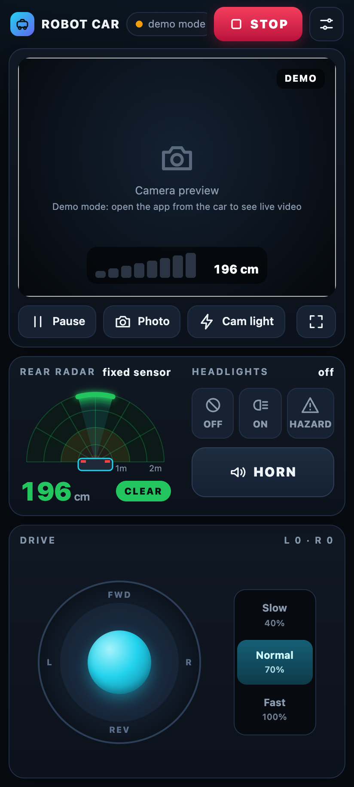
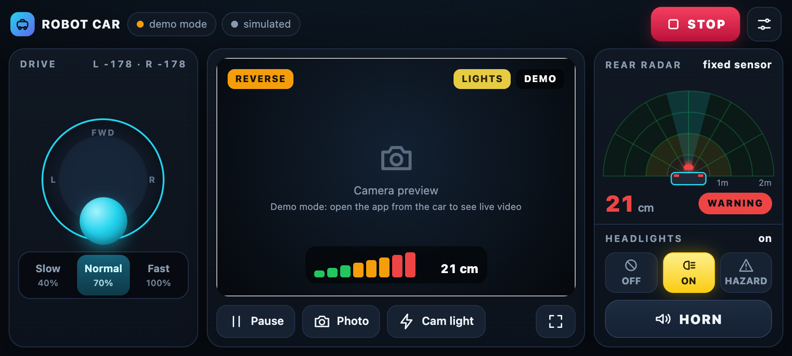
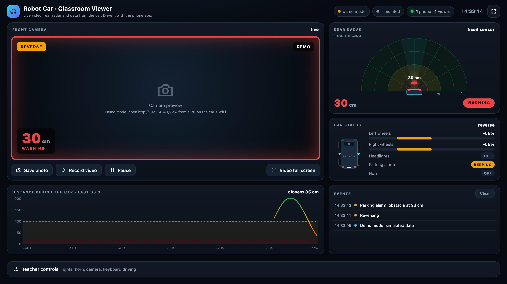
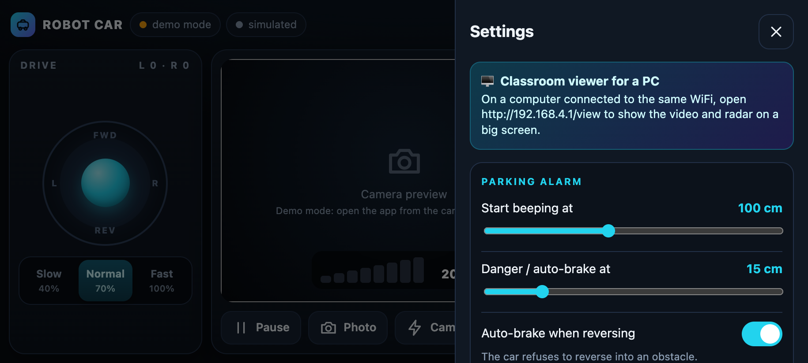

# 04 · Software Setup, Flashing & Web App Guide

> **Printable Edition**: For classroom lab procedures, see [`docs/pdf/04_Software_and_App_Guide.pdf`](pdf/04_Software_and_App_Guide.pdf).

---

## Web Controller & Teleoperation Interface

The robot car requires **zero app installation**. Any mobile phone, tablet, or desktop PC connects directly to the vehicle's onboard Wi-Fi Access Point and controls it through a standard modern web browser (Safari, Chrome, Firefox, Edge).

### Phone Driver Interface (Portrait & Landscape Modes)
<div align="center">
  <table border="0">
    <tr>
      <td align="center" width="48%">
        <b>📱 Mobile Portrait Driving Mode</b><br><br>
        
      </td>
      <td align="center" width="48%">
        <b>📱 Mobile Landscape Driving Mode</b><br><br>
        
      </td>
    </tr>
  </table>
</div>

### Desktop Classroom Observation Dashboard & Settings Panel
<div align="center">
  <table border="0">
    <tr>
      <td align="center" width="55%">
        <b>🖥️ Classroom Observation Viewer (<code>/view</code>)</b><br><br>
        
      </td>
      <td align="center" width="45%">
        <b>⚙️ Interactive Vehicle Settings Panel</b><br><br>
        
      </td>
    </tr>
  </table>
</div>

---

## 1. Development Environment Prerequisites

1. Download and install **Arduino IDE 2.x** from [arduino.cc/en/software](https://www.arduino.cc/en/software).
2. Open **Arduino IDE** → **Settings** (or **Preferences** on macOS).
3. In **Additional boards manager URLs**, add the official Espressif package repository:
   ```text
   https://espressif.github.io/arduino-esp32/package_esp32_index.json
   ```
4. Navigate to **Tools** → **Board** → **Boards Manager...**, search for `esp32`, and install **esp32 by Espressif Systems** (version 2.x or 3.x).
5. No third-party Arduino libraries need to be installed manually; all networking, camera drivers, and WebSocket handlers use core packages.

---

## 2. Firmware Flashing Procedure

### Board Configuration Matrix

| Parameter | Arduino UNO Firmware | ESP32-CAM Firmware |
|:---|:---|:---|
| **Project Path** | `firmware/uno_controller/uno_controller.ino` | `firmware/esp32cam_robot/esp32cam_robot.ino` |
| **Target Board** | **Arduino Uno** | **AI Thinker ESP32-CAM** |
| **CPU Frequency** | 16 MHz | 240 MHz (WiFi/BT) |
| **Flash Frequency** | — | 80 MHz |
| **Flash Mode** | — | QIO |
| **Partition Scheme** | Standard | **Huge APP (3MB No OTA/1MB SPIFFS)** *(Required)* |
| **Core Debug Level** | None | None |
| **Port Selection** | USB Serial Port of the Uno | USB Serial Port of the ESP32-CAM-MB daughterboard |

---

### Flashing the Arduino UNO
1. Connect the Arduino Uno to your computer via standard USB-B cable.
2. In the Arduino IDE, open `firmware/uno_controller/uno_controller.ino`.
3. Select **Board: Arduino Uno** and pick the corresponding serial port.
4. Click **Upload** (Ctrl+U / Cmd+U).
5. Upon successful flashing, the Arduino emits a **short chirp on the buzzer** and blinks the front headlights once to confirm initialisation.

---

### Flashing the ESP32-CAM
The ESP32-CAM requires a serial bridge (either the **ESP32-CAM-MB** daughterboard or an external FTDI USB-to-UART adapter).

#### Method A: Using the ESP32-CAM-MB Programmer Board (Recommended)
1. Snap the ESP32-CAM module firmly into the female headers of the ESP32-CAM-MB daughterboard.
2. Connect a micro-USB cable from your computer to the MB board.
3. Open `firmware/esp32cam_robot/esp32cam_robot.ino`.
4. Select **Board: AI Thinker ESP32-CAM** and ensure **Partition Scheme** is set to **Huge APP (3MB No OTA)**.
5. Click **Upload**. If the console displays `Connecting........_____.....`:
   * Press and hold the **IO0** push button on the daughterboard.
   * Tap the **RST** button once, then release **IO0**.
   * The upload will begin writing flash blocks.
6. Once the upload finishes, tap the **RST** button on the board to reboot the ESP32 into operational mode.

#### Method B: Using an FTDI USB-UART Adapter
1. Make the following temporary programming connections:
   * FTDI 5V → ESP32-CAM 5V
   * FTDI GND → ESP32-CAM GND
   * FTDI TX → ESP32-CAM U0R (Pin IO3)
   * FTDI RX → ESP32-CAM U0T (Pin IO1)
   * **ESP32-CAM IO0 → ESP32-CAM GND** *(Enables Bootloader Mode)*
2. Plug the FTDI adapter into the computer and upload.
3. Disconnect **IO0 from GND**, and tap the **RST** button to start the program.

---

## 3. Wi-Fi Connection & Accessing the Vehicle

1. Turn on the car's power switch. The small red status LED on the underside of the ESP32-CAM will blink, indicating it is waiting for client connections.
2. On your mobile phone, tablet, or laptop, open Wi-Fi settings and scan for networks:
   * **SSID**: `RobotCar`
   * **Password**: `12345678`
   *(If your phone displays a prompt stating "Wi-Fi has no Internet access", tap **Keep Wi-Fi Connection**).*
3. Open any modern web browser and navigate to:
   * **Mobile Driving App**: [`http://192.168.4.1`](http://192.168.4.1)
   * **Classroom / Big Screen Viewer**: [`http://192.168.4.1/view`](http://192.168.4.1/view)

---

## 4. Mobile Driver App Walkthrough (`/`)

The mobile driver interface is optimized for tactile feedback, responsive touch response, and low latency:

| Control Element | Interaction | Functionality |
|:---|:---|:---|
| **Virtual 360° Joystick** | Drag touch handle | Proportional steering and velocity. Center release immediately stops motors. |
| **Directional D-Pad Mode** | Tap Forward / Back / Left / Right | Alternative button control mode for precise incremental positioning. |
| **Speed Gears (Gears 1, 2, 3)** | Tap **Slow (40%)**, **Norm (70%)**, or **Fast (100%)** | Clamps peak motor PWM speed to prevent wheel slippage or battery sag. |
| **Emergency STOP Button** | Large Red Center Banner / `Esc` Key | Instantly cuts motor PWM to 0 and clears the drive buffer. |
| **Live FPV Video Feed** | Sub-100ms MJPEG Stream | Features heads-up dynamic overlays: active gear, reverse status, and radar bar. |
| **Headlights Toggle** | Tap **LIGHTS** button | Cycles front white headlights through **OFF → ON → HAZARD FLASH**. |
| **Acoustic Horn** | Press and hold **HORN** | Activates the active buzzer on the rear deck as long as held. |
| **Flashlight / Cam Light** | Tap **Flash** icon | Controls high-power white LED on ESP32-CAM pin IO4 with adjustable brightness. |
| **Snapshot Capture** | Tap **Camera** icon | Grabs high-resolution still JPEG directly to your phone camera roll. |
| **Full Screen** | Tap **Expand** icon | Enters browser immersive mode, hiding address and navigation bars. |

### Desktop Keyboard Shortcuts
When operating from a laptop or desktop computer, keyboard hotkeys are active:
* <kbd>W</kbd> or <kbd>▲</kbd> : Drive Forward
* <kbd>S</kbd> or <kbd>▼</kbd> : Drive Reverse
* <kbd>A</kbd> or <kbd>◄</kbd> : Turn Left
* <kbd>D</kbd> or <kbd>►</kbd> : Turn Right
* <kbd>Space</kbd> : Sound Horn
* <kbd>L</kbd> : Toggle Headlights
* <kbd>Esc</kbd> : Emergency Stop

---

## 5. Classroom Observation Viewer (`/view`)

The `/view` endpoint is designed for classroom projectors, STEM teachers, and telemetry logging:
* **High-Definition Stream Window**: Large video display with live telemetry HUD overlay (current distance, active flags, battery health indicator).
* **Synchronized Telemetry Dashboard**: Real-time instrument gauges showing wheel speeds, directional arrows, and light states.
* **Rolling 60-Second Sonar Chart**: Smooth real-time graph plotting obstacle distance over time.
* **Live Event Console**: Time-stamped event log documenting connection drops, obstacle warnings, and command transitions.
* **Telemetry Video Recording**: Record high-definition `.webm` video clips with embedded distance metadata and telemetry watermarks directly in the browser.
* **Multi-Screen Support**: Supports simultaneous streaming to **up to 3 screens** (e.g., student driver on mobile + classroom projector on laptop).

---

## 6. Software Customization & Web Assets

### Configuration File (`firmware/esp32cam_robot/config.h`)
Edit `config.h` before flashing to adjust network and camera defaults:
```c
// Wi-Fi Access Point Defaults
#define AP_SSID       "RobotCar"       // Unique name for classroom fleets (e.g. RobotCar-Team1)
#define AP_PASSWORD   "12345678"       // WPA2 Pre-shared key (min 8 chars)
#define AP_CHANNEL    6                // Select channels 1, 6, or 11 to avoid interference

// Station Mode (Optional: connect car to existing school network)
#define STA_SSID      ""               // Leave blank for standalone Access Point mode
#define STA_PASSWORD  ""

// Camera Defaults
#define CAM_FRAMESIZE FRAMESIZE_QVGA   // Options: FRAMESIZE_QVGA, FRAMESIZE_VGA, FRAMESIZE_SVGA
#define CAM_QUALITY   12               // JPEG quality: 10 (highest) to 63 (lowest)
#define CAM_VFLIP     0                // Set to 1 if camera is mounted upside down
```

### Rebuilding Web Interface Headers
The HTML, CSS, and JavaScript source files reside in the `web/` directory (`web/index.html` and `web/view.html`). You can preview and test them locally in any browser using demo mode.

When you modify the web interface, run the build script to pack and minify the assets into C header files for the ESP32:
```bash
python3 tools/build_ui.py
```
This regenerates `firmware/esp32cam_robot/index_html.h` and `firmware/esp32cam_robot/view_html.h`. Re-upload the ESP32-CAM sketch to deploy your changes.
